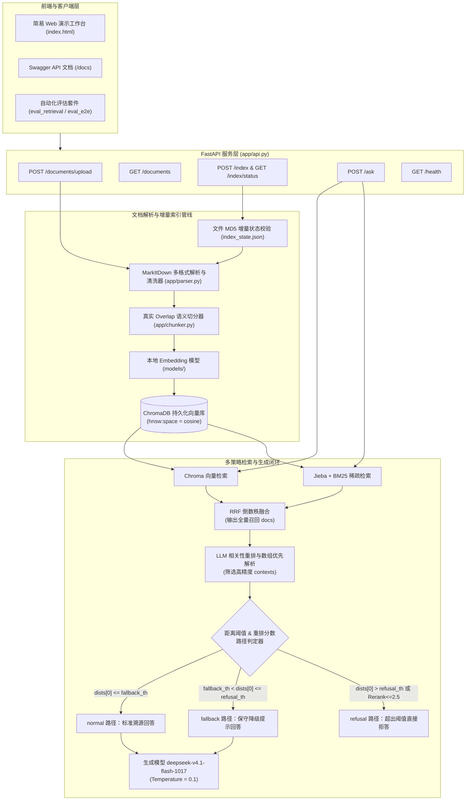
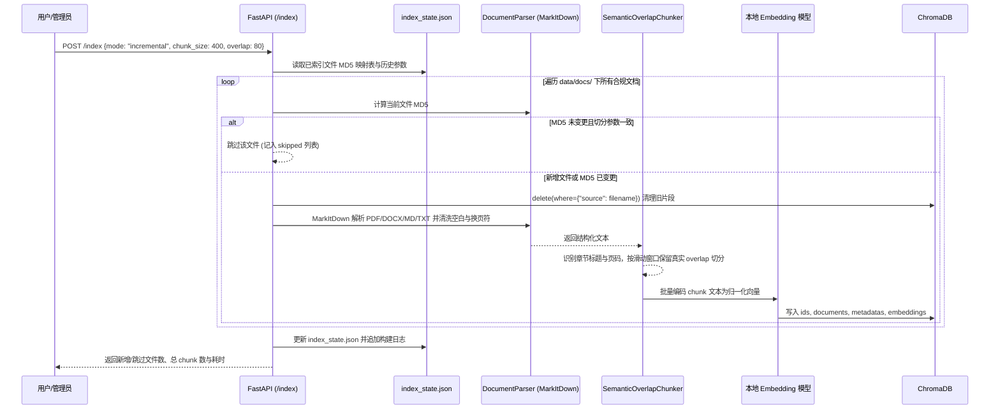

# 企业知识库问答系统（RAG）系统设计文档

- **课程名称**：《生成式大模型：原理和应用》
- **所属模块**：模块二：RAG 与知识库系统构建
- **项目名称**：企业知识库问答系统（星云智联企业制度与产品知识库）
- **运行环境**：macOS (Apple Silicon) · CPython 3.14.10 · `uv` 包管理器
- **核心技术栈**：FastAPI + ChromaDB + 本地 Embedding 模型 (`models/`) + OpenAI 兼容大模型接口 + `MarkItDown` (多格式解析) + `bm25s` & `rjieba` (混合检索)

---

## 一、 需求分析与设计目标

### 1.1 业务背景
企业内部沉淀了大量跨格式的规章制度与技术支持资料（如 Markdown 版《员工手册与考勤休假制度》、Word 版《差旅与费用报销管理规范》、PDF 版《IT信息安全与数据合规规范》以及 TXT 版《产品技术支持与运维 FAQ》）。通用聊天机器人无法获知企业私有制度，或容易在缺乏依据时产生“幻觉”编造数字与条款。

### 1.2 核心功能需求
1. **多格式文档接入与解析**：支持上传并解析 `.pdf`、`.docx`、`.txt`、`.md` 四类文档，校验文件类型与体积上限（≤ 20 MB）。
2. **数据清洗与真实 Overlap 语义切分**：支持可配置的 `chunk_size` 与 `overlap` 参数，**真正实现相邻文本块之间的上下文字符重叠**，并自动提取章节标题（`section`）与页码（`page`）。
3. **Chroma 向量持久化与 MD5 增量索引**：基于 `models/` 目录下的本地 Embedding 模型生成归一化向量并持久化至 ChromaDB；支持基于文件 MD5 的增量更新（跳过未修改文件，防止重复入库）与全量重建（`rebuild`），并提供索引状态与历史日志查询。
4. **可溯源检索增强问答与拒答机制**：
   - 先检索后回答，严格区分初始召回候选集 `docs` 与最终送入生成模型的 `contexts`；
   - 回答必须标注来源文件名与章节/片段 ID；
   - 基于评估集 `dists[0]` 分布校准距离阈值，对知识库未覆盖的问题走 `refusal` 拒答路径，对临界相关问题走 `fallback` 降级路径，严禁编造。
5. **基线与多策略优化对比闭环**：支持 `baseline`（纯向量检索+默认阈值）、`threshold_tuned`（距离阈值分布校准）、`hybrid`（向量 + BM25 RRF 混合检索）、`rerank`（LLM 重排）、`optimized`（混合检索 + LLM 重排 + 校准阈值）五种模式在线切换与公平评估对比。

---

## 二、 系统总体架构设计



---

## 三、 核心数据流设计

### 3.1 离线/在线文档入库与增量索引数据流


### 3.2 在线检索增强问答（`/ask`）数据流
1. **问题接收与分词/向量化**：接收用户 `query` 与 `mode` 参数；一路通过本地 Embedding 模型（带 `prompt_name="query"` 指令）生成查询向量，另一路通过 `rjieba` + 正则编号提取器（保留 `ERR-4029`、`SEC-2025-08` 等专有 token）分词。
2. **双路召回与 RRF 融合（产出 `docs`）**：向量检索与 `bm25s` 分别召回候选集，通过倒数秩融合公式 $\text{RRF}(d) = \frac{1.0}{60 + r_{\text{vec}}(d)} + \frac{0.85}{60 + r_{\text{bm25}}(d)}$ 排序，得到初始召回列表 `docs`（默认 `recall_k=8`），并记录最佳向量距离 `dists[0]`。
3. **LLM Rerank 重排（产出 `contexts`）**：在 `rerank` 或 `optimized` 模式下，将 `docs` 送入 `deepseek-v4.1-flash-1017` 进行 `0~10` 分相关性打分，经数组优先 JSON 解析器（`clean_json_text(..., prefer_array=True)` + 正则兜底）提取分数并截取前 `top_k=4` 作为真正送入生成器的 `contexts`。
4. **三级路径分流（`normal` / `fallback` / `refusal`）**：
   - 若 `dists[0] > refusal_threshold`（且无高分重排豁免）或重排最高分 $\le 2.5$：直接走 `refusal` 路径返回标准拒答说明，不调用生成 LLM，既杜绝幻觉又节省 Token；
   - 若 `fallback_threshold < dists[0] <= refusal_threshold` 或重排降级：走 `fallback` 路径，注入保守降级提示词；
   - 若 `dists[0] <= fallback_threshold`：走 `normal` 路径，调用生成模型输出带来源引用的精确回答。

---

## 四、 模块划分与职责说明

| 模块文件 | 核心类 / 函数 | 职责说明 |
| :--- | :--- | :--- |
| [`app/config.py`](../app/config.py) | `Settings` | 运行时加载 `.env`，读取 `OPENAI_API_KEY` 与通用 `OPENAI_BASE_URL`，统一管理模型名称、目录、文件大小限制与默认阈值。 |
| [`app/schemas.py`](../app/schemas.py) | `IndexRequest`, `AskRequest`, `AskResponse`, `SourceItem` | 定义严格的 Pydantic 请求/响应模型，明确分离 `sources`（精简溯源）、`docs`（全量召回）与 `contexts`（送入 LLM 的上下文），并支持 `use_cache` / `cache_hit`。 |
| [`app/parser.py`](../app/parser.py) | `DocumentParser` | 封装 `MarkItDown` 解析 PDF/DOCX/MD/TXT，提供 MD5 计算、换页符页码提取（`<!-- PAGE:N -->`）与噪声字符清洗。 |
| [`app/chunker.py`](../app/chunker.py) | `SemanticOverlapChunker` | 识别章节标题（`section`）与页码（`page`），按语义段落与句子切分，并通过 `prev_tail_overlap` 真正实现可配置的 `overlap` 重叠。 |
| [`app/indexer.py`](../app/indexer.py) | `KnowledgeBaseIndexer` | 管理 `models/` 目录下的本地 Embedding 模型单例、Chroma 持久化集合、基于 MD5 的增量/全量索引以及 `index_state.json` 状态日志。 |
| [`app/retriever.py`](../app/retriever.py) | `HybridRetriever` | 实现纯向量检索、`bm25s + rjieba` + 向量 RRF 混合检索、LLM Rerank 重排及实验模式切换。 |
| [`app/generator.py`](../app/generator.py) | `RAGGenerator` | 执行距离阈值与重排得分判定、System Prompt 组装、大模型调用、LRU 问答缓存、二次拒答检测以及耗时与 Token 统计。 |
| [`app/api.py`](../app/api.py) | FastAPI `app` | 暴露 `/documents/upload`、`/documents`、`/index`、`/index/status`、`/ask`、`/samples`、`/eval/results`、`/cache/stats`、`/cache/clear`、`/health` 接口并挂载静态前端与问答日志记录。 |
| [`eval/utils_json.py`](../eval/utils_json.py) | `clean_json_text`, `parse_rerank_scores_fallback` | 支持 `[...]` JSON 数组优先解析及正则兜底提取。 |

---

## 五、 接口定义（RESTful API 规范）

### 5.1 `POST /documents/upload` — 上传知识库文档
- **Content-Type**：`multipart/form-data` (`file`)
- **校验规则**：仅允许 `.pdf`, `.docx`, `.txt`, `.md`，单文件大小 `(0, 20MB]`。
- **返回示例**：
```json
{
  "message": "文档上传成功，请调用 POST /index 进行增量或重建索引",
  "filename": "员工手册与考勤休假制度.md",
  "size_bytes": 4037,
  "file_md5": "f4c9a8..."
}
```

### 5.2 `POST /index` — 建索引 / 重建索引 / 增量索引
- **请求体 (`IndexRequest`)**：
```json
{
  "mode": "incremental",
  "chunk_size": 400,
  "overlap": 80,
  "collection_name": "enterprise_kb"
}
```
- **返回结构**：包含 `effective_mode`、`added_or_updated`、`skipped`、`total_chunks`、`latency_ms`。

### 5.3 `POST /ask` — 检索增强问答
- **请求体 (`AskRequest`)**：
```json
{
  "query": "员工入职满3年但未满5年，每年可享受多少天带薪年假？",
  "mode": "optimized",
  "top_k": 4,
  "recall_k": 8
}
```
- **返回体 (`AskResponse`)**：包含 `answer`、`sources`、`path`、`latency_ms`、`cache_hit`、`token_usage`，并同时返回 `docs` 与 `contexts` 明细：
```json
{
  "answer": "根据公司规定，司龄满 3 年但未满 5 年的正式员工，每年享有 10 天带薪年假 [来源: 员工手册与考勤休假制度.md - 第三章 各类假期标准与薪资计算]。",
  "sources": [
    {"source": "员工手册与考勤休假制度.md", "chunk_id": "员工手册与考勤休假制度_...", "distance": 0.2145}
  ],
  "docs": [...],
  "contexts": [...],
  "path": "normal",
  "mode": "optimized",
  "best_distance": 0.2145,
  "latency_ms": 1420,
  "token_usage": {"prompt": 612, "completion": 85, "total": 697}
}
```

### 5.4 辅助管理接口
- `GET /health`：返回服务状态、当前 LLM 模型、Embedding 模型、已索引文档数与总 chunk 数。
- `GET /documents`：返回 `data/docs/` 下所有文档的大小、MD5、是否已索引及各自 chunk 数量。
- `GET /index/status`：返回完整的 `data/index_state.json`（含每次建索引的历史日志）。
- `GET /samples`：返回单数据源管理的前端预置问答示例列表。
- `GET /eval/results`：动态读取 `outputs/e2e_eval_results.json`，返回端到端四模式对比指标与典型诊断案例。

---

## 六、 Chroma 元数据设计与真实 Overlap 切分策略

### 6.1 Chroma 集合与元数据设计
- **集合配置**：`metadata={"hnsw:space": "cosine"}`，采用余弦距离（由于本地 Embedding 模型输出向量已 L2 归一化，余弦距离 $d = 1 - \cos(\theta) \in [0, 2]$，数值越小表示语义越相近）。
- **每个 Chunk 的 Metadata 字段设计**：

| 字段名 | 类型 | 示例值 | 用途说明 |
| :--- | :--- | :--- | :--- |
| `source` | `str` | `"差旅与费用报销管理规范.docx"` | 追溯原始文档名称，用于生成引用及按文件删除旧块 |
| `chunk_id` | `str` | `"差旅与费用报销管理规范_8a3f1c_002"` | 全局唯一片段 ID（`{文件名}_{MD5前6位}_{三位序号}`） |
| `chunk_index` | `int` | `2` | 片段在文档内的顺序编号 |
| `section` | `str` | `"二、 职级划分与交通住宿报销标准"` | 自动提取的所属章节标题，注入 Prompt 与 BM25 索引 |
| `page` | `int` | `1` | 文档页码（针对多页 PDF 自动追踪页码变化） |
| `file_md5` | `str` | `"8a3f1c90..."` | 原始文件 MD5 校验值，支撑增量索引比对 |
| `char_len` | `int` | `386` | 当前片段字符数 |
| `overlap_len` | `int` | `80` | 与前一个相邻片段真实重叠的字符长度 |

### 6.2 滑动窗口 Overlap 语义切分算法
为满足企业文档标题—正文—表格/问答对按语义切分的需求，[`SemanticOverlapChunker`](../app/chunker.py) 采用两阶段切分：
1. **语义单元拆解**：识别 Markdown 标题（`#`）、中文章节号（`第X章/条`、`一、`）与 FAQ 题号（`Q1:`），维护当前 `section` 与 `page` 状态；若单个段落超过 `chunk_size - overlap`，按中文句末标点（`。！？；\n`）二次切分为语义完整的子句。
2. **滑动窗口真实重叠组装**：在构建第 $i$ 个 chunk（$i > 0$）时，显式将第 $i-1$ 个 chunk 尾部的 `overlap` 个字符（`prev_tail_overlap = chunk_text[-self.overlap:]`）作为当前 chunk 的起始前缀，随后顺序拼入新的语义单元直至逼近 `chunk_size`。这保证了跨段落边界的条款或公式上下文绝不会因硬切分而断裂。

---

## 七、 Prompt 工程设计

### 7.1 正常问答 System Prompt (`QA_SYSTEM_PROMPT`)
```text
你是企业内部知识库智能问答助手。请严格遵循以下铁律回答员工问题：
1. 【只依据材料回答】：你只能依据下方提供的【检索材料（Contexts）】回答问题，严禁动用任何外部常识、严禁编造或脑补材料中未出现的数字、条款或流程。
2. 【无相关内容明确拒答】：如果检索材料中没有包含回答该问题所需的信息，或者材料与问题无关，你必须直接回答：“抱歉，当前企业知识库材料中没有提到该问题相关的信息，无法为您解答。”，绝不能猜测或拼凑答案。
3. 【强制标注来源】：回答中的关键事实、数据、条款，必须在句末标注来源文件名与章节/片段编号，格式如：`[来源: 员工手册与考勤休假制度.md - 第三章]`。
4. 【跨段综合与精确计算】：当问题涉及多个段落或计算时，请分步引用对应材料条款并给出清晰的推导结果。
```
- **生成参数**：`temperature = 0.1`（低温抑制随机发散），`max_tokens = 900`。

### 7.2 降级问答 System Prompt (`FALLBACK_SYSTEM_PROMPT`)
当最佳检索距离落入模糊区间 `(fallback_threshold, refusal_threshold]` 时启用，要求模型在开头明确标注`【提示：检索相关度中等，以下仅基于现有相近条款供参考】`，且若核对后发现确无直接依据则立即转为拒答。

### 7.3 LLM Rerank 与 LLM-as-Judge Prompt
- **Rerank Prompt**：要求模型对候选 `docs` 输出 `[{"index": 0, "score": 9.5}, ...]` 的 JSON 数组，由修复后的 `clean_json_text(..., prefer_array=True)` 解析。
- **Judge Prompt (`JUDGE_SYSTEM`)**：要求模型将回答拆解为原子声明（`claims`），核对每条声明是否受 `contexts` 支持（**明确允许基于材料条款的合理算术与逻辑推导**，避免严厉裁判误伤跨段计算题），输出 `total_claims`、`supported_claims`、`claim_support_rate` 与 `correctness_score`。

---

## 八、 异常处理与降级策略

1. **检索层拒答与降级保护**：
   - 知识库为空或未召回任何结果时，直接返回 `path="refusal"`；
   - 向量距离 `dists[0] > refusal_threshold` 且无高分 Rerank 豁免时，短路拦截直接返回 `path="refusal"`，不调用生成 LLM。
2. **Rerank JSON 解析异常降级**：
   - 修复 `clean_json_text` 数组优先提取；若 LLM 输出格式损坏，自动触发正则提取兜底 `parse_rerank_scores_fallback`；若极端情况下仍为空，自动降级为保留初始 RRF/向量排序前 `top_k` 个片段并将路径标记为 `fallback`，绝不中断问答服务。
3. **LLM 接口网络或限流异常兜底**：
   - 捕获 OpenAI SDK 调用异常，优雅返回 `path="error"` 与错误诊断说明，HTTP 层保持结构化响应而不抛出未捕获的 500 崩溃。

---

## 九、 评估方案设计

1. **评估集设计（30 题）**：
   - `direct_fact`（明确答案题，12 题）：单一段落事实、数字、错误码查询；
   - `multi_hop`（跨段综合题，10 题）：跨章节计算（如考勤扣款+事假公式+审批流、拼房上浮+差旅补贴计算）与跨文档综合（如上传体积限制+数据密级+OCR耗时）；
   - `unanswerable`（无答案拒答题，8 题）：期权行权、欧洲差旅津贴、食堂补贴、未收录错误码 `ERR-9099` 等。
2. **两阶段评估指标口径**：
   - **第一阶段（纯检索评估，不调 LLM）**：在 22 道有答案题上计算 `Hit@K`、`Recall@K`、`Precision@K`、`MRR@K`（$K \in \{3, 5, 8\}$）；8 道无答案题单独统计不同阈值下的拒答准确率与 `dists[0]` 分布，完成距离阈值科学校准。
   - **第二阶段（端到端评估）**：固定生成模型 `deepseek-v4.1-flash-1017` 与 Embedding 模型 `Qwen3-Embedding-0.6B`，按控制变量法依次评估 `baseline`、`threshold_tuned`、`hybrid`、`optimized`，统计有答案正确率、忠实度（逐条声明支持率）、无答案拒答准确率、误拒率、平均/P95 延迟、问答 Token 与裁判 Token（严格分离统计）及四类 `path` 分布，并附 10 道题目的人工抽检复核表。
